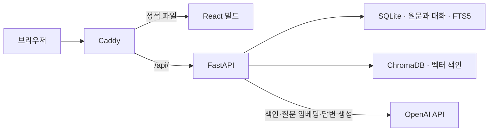

# 🦝 RAGcoon

**Dig into knowledge, one chunk at a time.**

RAGcoon은 RAG(Retrieval-Augmented Generation, 검색 증강 생성)와 AI Agent를 직접 구현하고 실험하는 풀스택 스터디 프로젝트다. 문서와 질문이 주어졌을 때 **어떤 문단이 검색됐고, 답변이 그 문단의 어떤 내용에 근거하는지** 확인할 수 있는 서비스를 만드는 것이 목표다.

Markdown·텍스트 PDF를 등록하고, 검색된 문단을 바탕으로 답변을 받아 인용 원문까지 확인할 수 있다. 같은 질문으로 기본 RAG와 한 번 더 검색할 수 있는 Agent의 결과도 비교한다.

**현재 상태:** 로컬에서 문서 등록부터 채팅 기록 복원까지 검증하고 실제 모델로 [한국어 합성 질문 10개를 평가](docs/wiki/evaluation.md#실제-모델-평가-결과)했다. OCI ARM64 VM에서도 비공개로 기동해 검색을 확인했다. 아직 인터넷에 공개하지 않았다.

## 개발 사양

| 영역 | 기술 | 역할 |
|---|---|---|
| 프론트엔드 | React, TypeScript, Vite, pnpm | 문서 업로드, 검색 결과, 스트리밍 채팅과 인용 원문 표시 |
| 백엔드 | Python 3.12, FastAPI, Pydantic, uv | 문서 처리, 요청 검증, 검색·채팅 API |
| 저장·검색 | SQLite FTS5, ChromaDB | 문서·청크·대화 보관, BM25 희소 검색과 벡터 밀집 검색. 기본값은 두 순위를 합치는 하이브리드(RRF) |
| 모델 | OpenAI `text-embedding-3-small`, `gpt-4.1-mini` | 문서·질문 임베딩, 검색 근거 기반 답변 생성 |
| RAG·Agent | LangChain, LangGraph | 모델 연동, 근거 판정과 조건부 재검색 |
| 평가·관측 | 한국어 합성 평가셋, LangSmith | 기본 RAG와 Agent 비교. 원격 추적은 선택 사항이며 미검증 |
| 개발·테스트 | Pytest, Vitest, Biome, Husky | 백엔드·프론트 검사, 포맷·린트와 커밋 전 검사 |
| 실행·배포 | Docker Compose, Caddy | 로컬 컨테이너 실행, 정적 파일 제공과 API 리버스 프록시. OCI·GitHub Actions 배포는 계획 단계 |

## 아키텍처



SQLite와 ChromaDB는 별도 DB 서버 없이 API 컨테이너에서 사용한다. 두 저장소의 데이터는 같은 Docker 볼륨에 보관해 컨테이너 교체 후에도 유지한다.

## 저장소 구조

```text
apps/web/             React 화면과 프론트 테스트
apps/api/app/         FastAPI, 문서·검색·채팅·Agent 구현
apps/api/evaluation/  평가 질문·정답 근거와 실행기
apps/api/tests/       백엔드 테스트
infra/Caddyfile       정적 파일·API 경로 분기
compose.yaml          로컬 서비스·포트·볼륨
docs/                 PRD, 작업 플랜, 학습 위키
```

## 개발 로드맵과 배포 목표

1. **로컬 기반·문서 검색·채팅:** Markdown/PDF 등록부터 세 검색 방식, 인용 답변, 대화 복원까지 구현하고 로컬에서 검증했다.
2. **Agent·평가:** 기본 RAG와 조건부 재검색 Agent를 오프라인 대역 및 실제 OpenAI 모델로 비교했다. LangSmith 원격 추적은 아직 검증하지 않았다.
3. **배포·운영:** OCI 오사카 Ampere A1(ARM64, 2 OCPU, 메모리 12GB, Ubuntu 24.04)에서 비공개로 실행 중이다. 공개 HTTPS, GitHub Actions 배포와 백업·복구는 향후 작업이다. 향후 무료 적용은 확정되지 않았으며 외부 모델 비용은 별도다.

## 빠른 시작

Docker Compose가 설치된 환경에서 저장소 루트에서 실행한다.

```sh
docker compose up -d --build
```

[로컬 화면](http://127.0.0.1:18730/)에서 문서를 등록하고 원문을 확인하는 데에는 API 키가 필요 없다. 중지할 때는 `docker compose stop`을 사용한다.

실제 색인·AI 채팅을 사용하려면 `compose.yaml` 옆의 `.env`에 `OPENAI_API_KEY`를 설정하고 `docker compose up -d api`로 적용한다. 색인을 시작하면 문서 조각이, 답변을 생성하면 질문과 검색 근거가 OpenAI로 전송되며 비용이 발생할 수 있다. 키를 Git에 커밋하거나 프론트엔드에 설정하지 않는다.

## 더 읽기

- [학습 위키 — L01~L07](docs/wiki/README.md): 화면의 요청부터 검색·인용·평가까지, 설계 이유와 직접 확인하는 방법
- [제품 요구사항](docs/prd.md): 기능 범위와 인수 기준
- [작업 플랜](docs/work-plan.md): 단계별 검증 결과, 미확인 항목과 OCI 배포 계획
