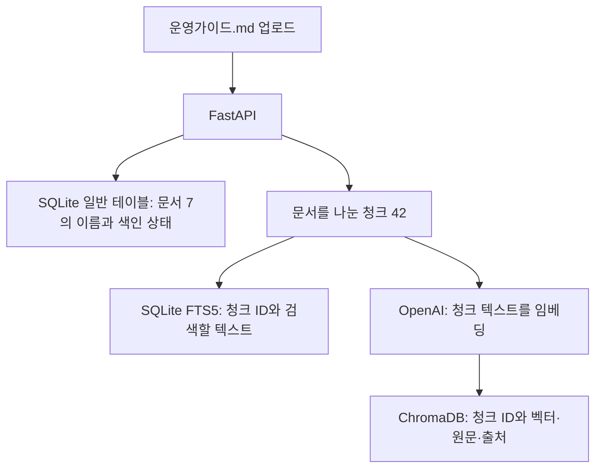

# 문단 하나로 보는 RAGcoon의 DB 흐름

**설계 예시이며 실행 결과는 아니다.** `운영가이드.md`에 “백업은 매일 새벽 3시에 실행한다”라는 문단이 있다고 하자. 이 문서의 ID를 `7`, 문단을 나눈 조각(청크)의 ID를 `42`라고 부르겠다. 숫자는 설명용이다.

## 1. 업로드하면 무엇을 어디에 저장할까?

SQLite를 두 번 표시했지만 DB 서버가 두 개라는 뜻은 아니다. **같은 SQLite DB** 안에서 일반 테이블은 문서 목록·채팅 기록을 관리하고, FTS5는 텍스트를 단어로 찾는 역할을 한다. FTS5에 문단 텍스트를 넣으면 책 뒤의 찾아보기처럼 `새벽 → 청크 42`라는 관계를 색인한다. 여기에 임베딩 벡터는 넣지 않는다.

ChromaDB에는 같은 청크를 의미로 찾기 위한 벡터가 들어간다. 두 색인이 모두 완성돼야 SQLite의 문서 상태를 ‘검색 준비 완료’로 바꾼다. 한쪽만 성공한 문서가 모드에 따라 보였다 사라지는 일을 막기 위해서다.

## 2. 질문하면 어느 DB를 읽을까?

| 사용자 동작 | 백엔드가 읽는 곳 | 이 예시에서 확인하는 것 |
|---|---|---|
| 업로드 목록 열기 | SQLite 일반 테이블 | 문서 7의 이름과 준비 상태. 문단 검색이나 모델 호출이 필요 없다. |
| `새벽`으로 희소 검색 | SQLite FTS5 | `새벽`이 들어간 문단을 찾고 BM25로 순위를 매긴다. 질문을 벡터로 만들지 않는다. |
| `복사본을 만드는 시간은?`으로 밀집 검색 | ChromaDB 벡터 색인 | OpenAI로 질문을 벡터화한 뒤 가까운 청크를 찾는다. 질문에 `새벽`이 없어도 42번이 후보가 될 수 있다. |
| 같은 질문으로 하이브리드 검색 | SQLite FTS5와 ChromaDB | 각 검색의 순위 목록을 FastAPI에서 RRF로 합친다. 두 목록에 42번이 모두 있어도 화면에는 한 번만 나온다. |

**검색 결과는 답변이 아니라 근거 후보**다. 검색 화면에서는 모델에게 답변을 쓰게 하지 않고도 문단과 출처를 볼 수 있다. 채팅에서는 선택한 검색 방식이 찾아온 문단을 채팅 모델에 전달하고, 생성한 답변에서 해당 원문을 열 수 있게 한다. 대화 기록은 SQLite 일반 테이블에 저장한다.

[제품 요구사항](prd.md) · [구현 순서: L02 문서 등록과 L03 검색](work-plan.md)
