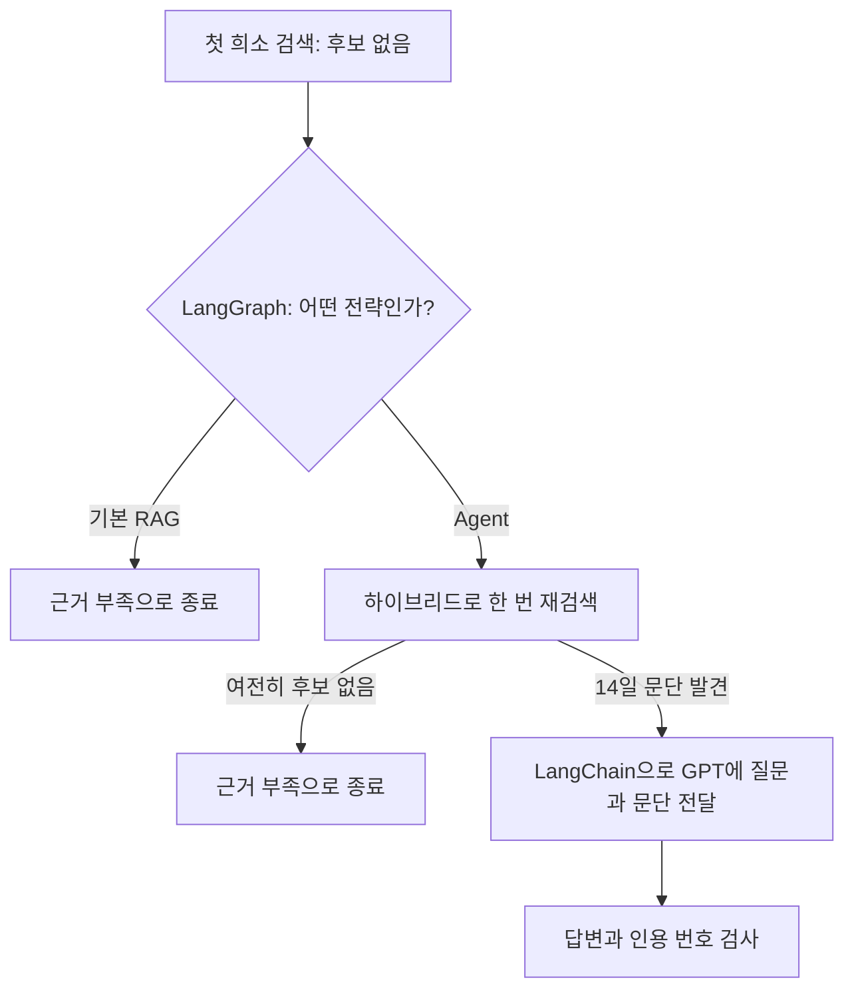

# LangChain·LangGraph·LangSmith는 각각 무슨 일을 할까?

세 이름은 **AI 모델 세 개도, 질문이 차례대로 통과하는 세 단계도 아니다.** RAGcoon을 만들면서 생기는 서로 다른 질문에 답하는 도구다.

| 개발자의 질문 | 도구 | RAGcoon에서 하는 일 |
|---|---|---|
| 질문과 검색 근거를 모델에 어떻게 보내고 답변을 받을까? | **LangChain** — 모델·도구를 앱 코드에 연결하는 라이브러리 | `ChatOpenAI`로 `gpt-4.1-mini`를 호출하고 답변을 조금씩 받는다. 답을 쓰는 것은 GPT이지 LangChain이 아니다. |
| 검색 결과가 없으면 끝낼까, 다른 방식으로 다시 찾을까? | **LangGraph** — 상태와 조건에 따라 다음 단계를 실행하는 라이브러리 | 검색 방식·후보 문단·재검색 여부를 기억하고, 개발자가 정한 조건에 따라 생성·재검색·종료 중 다음 경로를 고른다. |
| 어제는 왜 실패했고, 검색 방식을 바꾼 뒤에는 나아졌을까? | **LangSmith** — 실행을 기록하고 비교·평가하는 서비스 | 선택한 합성 실험의 실행 요약을 원격에서 살펴보는 용도다. 검색이나 답변 생성을 대신하지 않는다. |

## 예시: “빌린 책은 언제까지 돌려줘야 해?”

테스트 문서에는 **“도서관에서 빌린 책은 14일 안에 반납해야 합니다.”**라고 적혀 있다. 아래는 비교 화면에서 **첫 희소 검색이 문단을 못 찾았다고 가정한 두 경로**다. 같은 질문이어도 전략에 따라 결과가 달라질 수 있다.

여기서 Agent가 더 똑똑한 모델을 쓴 것은 아니다. **차이는 근거를 못 찾았을 때 한 번 더 찾아보는 규칙**이다. 또 인용 번호 검사를 통과했다고 답이 사실이라는 뜻은 아니다. 실제로 인용된 문장이 ‘14일’을 뒷받침하는지 봐야 한다.

## LangSmith는 무엇을 확인하고, 무엇은 확인하지 못할까?

- **추적(Tracing)은 한 번의 실행을 본다.** “왜 빈 답이 나왔지?”라면 후보가 없었는지, 재검색했는지, 어느 단계에서 끝났는지를 본다. RAGcoon은 비교 화면에서도 이 순서를 보여준다. LangSmith를 켜야만 알 수 있는 정보는 아니다.
- **평가(Evaluation)는 여러 실행을 같은 기준으로 비교한다.** “재검색이 도움이 됐나?”라면 같은 질문 세트를 두 전략에 넣고, 정답 문단이 상위 3개에 포함된 횟수와 답변이 올바른 근거를 인용한 횟수를 따로 센다. 실행 기록을 남기는 것만으로 정답 여부가 판정되지는 않는다. RAGcoon의 [정답표와 평가 결과](evaluation.md)는 LangSmith 없이도 확인할 수 있다.

**이 프로젝트에서 LangSmith는 선택 사항이다.** 일반 질문·문서 원문·답변은 LangSmith에 보내지 않는다. 별도 합성 평가에서 명시적으로 켰을 때만 전략·실행 단계·종료 사유·인용 수 같은 요약을 보내도록 구현했다. 전송할 필드는 로컬에서 확인했고, 원격 대시보드 수신은 검증하지 않았다. 추적을 꺼도 실제 GPT나 임베딩 모델을 호출하면 OpenAI 비용은 별도로 발생할 수 있다.

**코드에서 찾기:** [모델 호출 `GroundedChat.stream`](../../apps/api/app/chat_model.py) · [실행 분기 `_next`와 `_retry`](../../apps/api/app/agent.py) · [전송 필드 `record_synthetic_trace`](../../apps/api/app/experiment_trace.py)
