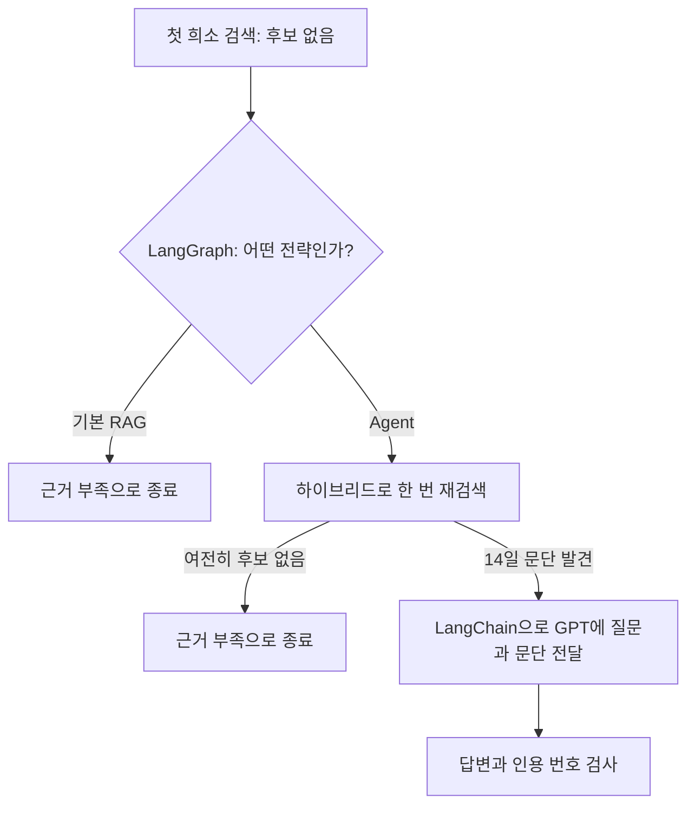

# LangChain·LangGraph·LangSmith는 각각 무슨 일을 할까?

세 이름은 **AI 모델 세 개도, 질문이 차례대로 통과하는 세 단계도 아니다.** RAGcoon을 만들면서 생기는 서로 다른 질문에 답하는 도구다.

## 소스는 어디부터 읽을까?

출발점은 일반 채팅의 [`ChatStream.generate()`](../../apps/api/app/chat.py#L137)다. `retrieve(...)`가 문단을 찾고, 후보가 있을 때만 `self.model.stream(질문, 후보)`로 답변을 요청한다. **여기에는 LangGraph가 없다.** 이 두 호출을 기준으로 세 도구가 맡는 일을 구분하면 된다.

### 1. LangChain — 찾은 문단을 어떻게 GPT에 전달할까?

[`chat_model.py`의 `GroundedChat.stream()`](../../apps/api/app/chat_model.py#L59)에서 `payload`와 `.astream()`을 차례로 본다. `payload`는 **우리 코드**가 만든 질문과 번호 붙은 원문이다. `ChatOpenAI.astream()`은 **LangChain의 OpenAI 연동 기능**으로, 이 자료와 답변 지침을 GPT에 보내고 생성된 텍스트를 조금씩 받는다. 검색할 문단을 고르는 일은 이미 끝났다. [문서·질문 임베딩](../../apps/api/app/vectors.py#L44)도 이 호출이 아니라 OpenAI SDK가 직접 처리한다.

### 2. LangGraph — 같은 질문인데 왜 Agent만 다시 검색할까?

[`agent.py`의 `_build_graph()`](../../apps/api/app/agent.py#L127)에서 `add_node`는 **실행할 함수**, `add_conditional_edges`는 **그 함수가 끝난 뒤 갈 수 있는 경로**로 읽는다. 갈림길은 [`_next()`](../../apps/api/app/agent.py#L109)다. 첫 검색에 후보가 없으면 기본 전략은 끝나고, Agent는 `_retry()`에서 검색 방식을 바꾼다. `run_strategy()`의 `_GRAPH.ainvoke(...)`가 이 규칙대로 질문 하나를 실행한다. **비교 화면의 두 전략은 같은 그래프를 쓰고, 일반 채팅은 이 그래프를 거치지 않는다.**

### 3. LangSmith — 실행이 끝나면 무엇을 남길까?

먼저 [평가 CLI의 `evaluate()`](../../apps/api/evaluation/__main__.py#L75)에서 `trace_this`를 본다. 기본값은 전송하지 않는 것이고, `--trace-synthetic`을 선택해야 **첫 합성 질문·첫 검색 방식에 대해 두 전략의 요약**을 보낸다. 다음으로 [`experiment_trace.py`의 `record_synthetic_trace()`](../../apps/api/app/experiment_trace.py#L23)에서 `client.create_run()`의 입력과 출력을 비교한다. 입력은 질문 원문이 아니라 **검색 방식과 전략**, 출력은 답변 원문이 아니라 **거친 단계·결과 상태·종료 사유·인용 수**다.

## 예시: “빌린 책은 언제까지 돌려줘야 해?”

테스트 문서에는 **“도서관에서 빌린 책은 14일 안에 반납해야 합니다.”**라고 적혀 있다. 아래는 비교 화면에서 **첫 희소 검색이 문단을 못 찾았다고 가정한 두 경로**다. 같은 질문이어도 전략에 따라 결과가 달라질 수 있다.

여기서 Agent가 더 똑똑한 모델을 쓴 것은 아니다. **차이는 근거를 못 찾았을 때 한 번 더 찾아보는 규칙**이다. 또 인용 번호 검사를 통과했다고 답이 사실이라는 뜻은 아니다. 실제로 인용된 문장이 ‘14일’을 뒷받침하는지 봐야 한다.

## LangSmith는 무엇을 확인하고, 무엇은 확인하지 못할까?

- **추적(Tracing)은 한 번의 실행을 본다.** “왜 빈 답이 나왔지?”라면 후보가 없었는지, 재검색했는지, 어느 단계에서 끝났는지를 본다. RAGcoon은 비교 화면에서도 이 순서를 보여준다. LangSmith를 켜야만 알 수 있는 정보는 아니다.
- **평가(Evaluation)는 여러 실행을 같은 기준으로 비교한다.** “재검색이 도움이 됐나?”라면 같은 질문 세트를 두 전략에 넣고, 정답 문단이 상위 3개에 포함된 횟수와 답변이 올바른 근거를 인용한 횟수를 따로 센다. 실행 기록을 남기는 것만으로 정답 여부가 판정되지는 않는다. RAGcoon의 [정답표와 평가 결과](evaluation.md)는 LangSmith 없이도 확인할 수 있다.

**검증 범위:** 전송할 필드는 로컬에서 확인했고, LangSmith 대시보드에 기록이 도착하는지는 아직 검증하지 않았다. 추적을 끄는 것과 실제 GPT·임베딩 호출 비용은 별개다.

**직접 확인:** 로컬 API가 실행 중이라면 저장소 루트에서 `docker compose exec api .venv/bin/python -m evaluation`을 실행한다. 출력에서 같은 `case_id`와 `mode`의 `baseline`·`agent`를 골라 `steps`와 `stop_reason`을 비교한다. 옵션 없는 이 실습은 로컬 대역 모델을 사용하므로 LangGraph 분기는 관찰할 수 있지만 실제 GPT 호출이나 LangSmith 수신을 시험하지 않는다.
